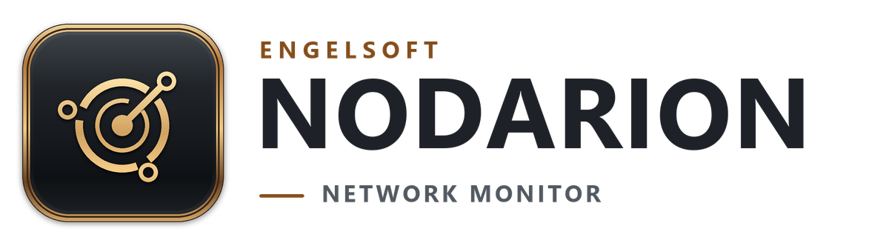
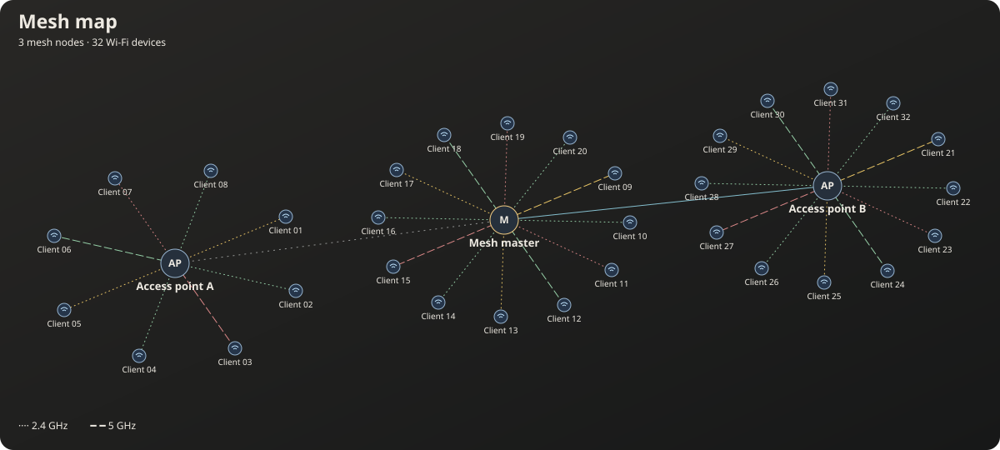

  <picture>
    <source media="(prefers-color-scheme: dark)" srcset="https://raw.githubusercontent.com/engelsofta/nodarion/main/custom_components/nodarion/brand/dark_logo@2x.png">
    
  </picture>

  <strong>Deutsch</strong> · <a href="README.md">English</a>

<h1 align="center">Engelsoft Nodarion für Home Assistant</h1>

  
  
  
  

   
  Nodarion gefällt dir? Ein Kaffee unterstützt die Weiterentwicklung und Verbesserungen. ☕

**Sieh direkt in Home Assistant, welche Geräte in deinem Netz sind, was sich geändert hat und wo du nachsehen solltest.**

[Im Marketplace öffnen](https://my.home-assistant.io/redirect/marketplace_repository/?owner=engelsofta&repository=nodarion&category=integration) · [Versionshinweise und Downloads](https://github.com/engelsofta/nodarion/releases) · [Home-Assistant-Community](https://community.home-assistant.io/t/nodarion-network-monitoring-with-fritz-box-mesh-and-adguard-home-in-one-ha-panel/1028102)

## Was Nodarion kann

- **Geräte finden und verwalten.** Lokale Ping-/TCP-Scans und optional die FRITZ!Box liefern die Geräteübersicht. Suche, Filter und frei wählbare Spalten helfen beim Eingrenzen. Erkannte Geräte-Weboberflächen kannst du direkt öffnen.
- **WLAN und VLANs untersuchen.** Die WLAN-Diagnose zeigt Mesh-Zugangspunkte, Verbindungsraten und Signalstärke mit dBm-Filter. Dazu kommen Mesh-Wechsel, DHCP-Leases und Warnungen, wenn bekannte Geräte das Segment wechseln.
- **DNS live verfolgen.** AdGuard Home oder Pi-hole 6 liefern Anfragen, Blockquoten und Live-Protokoll pro Gerät. Schutz und unterstützte Domain-Regeln lassen sich aus Home Assistant steuern. AdGuard Home unterstützt außerdem Filterlisten und DNS-Umschreibungen.
- **Wichtige Geräte überwachen.** Erfasse Anwesenheit und Gastaktivität und erhalte Warnungen für unbekannte, instabile oder ausgefallene Geräte. Benachrichtigungen und das Ereignis `nodarion_alert` lassen sich mit Home-Assistant-Automationen kombinieren.
- **FRITZ!Box-Zugang verwalten.** Sieh verbundene Gäste, schalte das Gast-WLAN und lasse neue Geräte bei Bedarf erst nach Freigabe ins Internet.
- **Optionale KI-Analyse nutzen.** Lass das Netz auf Wunsch manuell oder täglich über eine Home-Assistant-KI-Aufgabe zusammenfassen. Die DNS-Datenschutzeinstellungen bestimmen, welche Daten übermittelt werden.

## Live-Karte für FRITZ!Mesh

Sieh, mit welchem Zugangspunkt jedes WLAN-Gerät verbunden ist. Das Linienmuster zeigt das Frequenzband, die Farbe die Signalstärke. Ein Klick auf einen Knoten öffnet die Verbindungsdetails. Über die Legende kannst du die Karte filtern.

## Installation und Einrichtung

1. Installiere **Nodarion** aus dem Home Assistant Marketplace (ab Home Assistant 2026.11) oder [lade die aktuelle Version herunter](https://github.com/engelsofta/nodarion/releases/latest). Für die manuelle Installation kopiere die Integration nach `custom_components/nodarion` und starte Home Assistant neu.
2. Wähle **Einstellungen → Geräte & Dienste → Integration hinzufügen → Engelsoft Nodarion** und bestätige dein IPv4-Subnetz.
3. Öffne **Nodarion** in der Seitenleiste. FRITZ!Box, DNS-Anbieter und KI-Analyse sind optional und lassen sich über **Konfigurieren** einrichten.

Home Assistant muss die überwachten Subnetze erreichen. FRITZ!Box-Funktionen setzen TR-064 voraus. Für die DNS-Auswertung wird das Abfrageprotokoll eines Anbieters benötigt. Pi-hole 6 verwendet ein Anwendungspasswort. Schreibaktionen benötigen ein Home-Assistant-Administratorkonto. Die KI-Analyse ist standardmäßig aus. Bei Cloud-KI werden die Daten der Analyseanfrage an den Anbieter übermittelt.

[Fehler melden oder Idee teilen](https://github.com/engelsofta/nodarion/issues) · [Lizenz](LICENSE)
