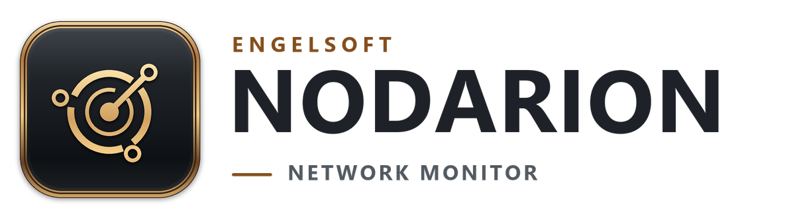
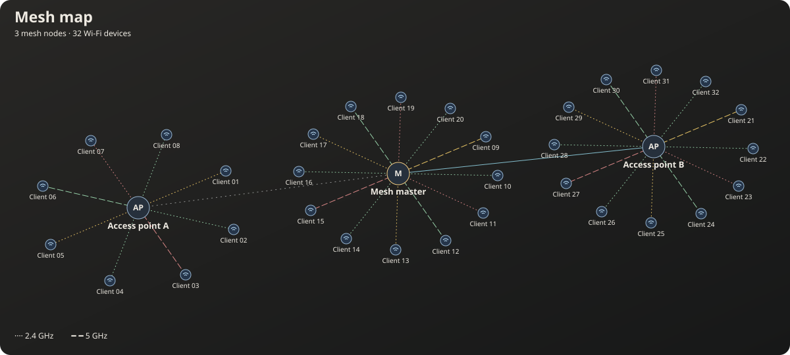

  <picture>
    <source media="(prefers-color-scheme: dark)" srcset="https://raw.githubusercontent.com/engelsofta/nodarion/main/custom_components/nodarion/brand/dark_logo@2x.png">
    
  </picture>

  <a href="README.de.md">Deutsch</a> · <strong>English</strong>

<h1 align="center">Engelsoft Nodarion for Home Assistant</h1>

  
  
  
  

   
  Enjoy Nodarion? A coffee helps support development and improvements. ☕

**See what’s on your network, what changed, and what needs attention — right in Home Assistant.**

[Install from the Marketplace](https://my.home-assistant.io/redirect/marketplace_repository/?owner=engelsofta&repository=nodarion&category=integration) · [Release notes and downloads](https://github.com/engelsofta/nodarion/releases) · [Home Assistant Community](https://community.home-assistant.io/t/nodarion-network-monitoring-with-fritz-box-mesh-and-adguard-home-in-one-ha-panel/1028102)

## What you can do

- **Inventory your network.** Discover devices with local ping/TCP scans and optional FRITZ!Box integration. Search, sort, filter, customize columns, or jump from the compact overview to Wi-Fi diagnostics. Open detected device web interfaces directly.
- **Troubleshoot Wi-Fi and segments.** See Mesh access points and handovers, link rates, signal strength, DHCP leases and configurable VLANs. Filter Wi-Fi devices by a dBm threshold and get alerts when known devices move between segments.
- **See DNS activity live.** Connect AdGuard Home or Pi-hole 6 for per-device query counts, block rates, a live log and activity charts. Manage protection and supported allow/block rules from Home Assistant. AdGuard Home also supports filters and rewrites.
- **Monitor what matters.** Mark important devices, track presence, review device and guest activity, and get alerts for unknown, unstable or offline devices. Use Home Assistant notifications or the `nodarion_alert` event in automations.
- **Manage FRITZ!Box access.** View connected guests, toggle guest Wi-Fi and, when configured, hold internet access for new devices until you approve them.
- **Get optional AI summaries.** Run network analysis through a Home Assistant AI Task, on demand or daily. DNS privacy controls determine which data is sent.

## Live FRITZ!Mesh map

See which access point each Wi-Fi device uses. Line patterns identify the band and colors show signal quality. Select a node for link details, or click the legend to filter the map.

## Install and connect

1. Install **Nodarion** from the Home Assistant Marketplace (Home Assistant 2026.11+) or [download the latest release](https://github.com/engelsofta/nodarion/releases/latest). For manual installation, place the integration in `custom_components/nodarion` and restart Home Assistant.
2. In **Settings → Devices & services → Add integration**, choose **Engelsoft Nodarion** and confirm your IPv4 subnet.
3. Open **Nodarion** from the sidebar. Add FRITZ!Box, a DNS provider or AI analysis via the integration’s **Configure** dialog when needed.

Home Assistant needs access to monitored subnets. FRITZ!Box features require TR-064. Use one DNS provider at a time and enable its query log for per-device reporting. Pi-hole 6 uses an application password. Administrative actions require a Home Assistant administrator. AI analysis is off by default. A cloud AI provider receives the data included in its analysis request.

[Report an issue or share an idea](https://github.com/engelsofta/nodarion/issues) · [License](LICENSE)
